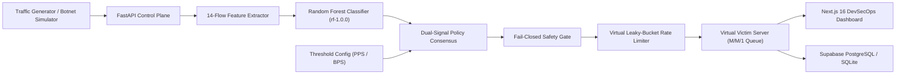

# SENTRIX — Autonomous AI DDoS Detection & Defense Platform

> **Detect Threats in Seconds. Block Malicious Traffic. Keep Real Users Connected.**

SENTRIX is an autonomous, machine-learning-driven DDoS detection and mitigation simulation platform. It combines a trained Random Forest classification model with statistical volumetric thresholds and a fail-closed safety gate to defend web infrastructure without knocking real customers offline.

---

## The Problem Statement

### Why Traditional DDoS Defenses Fail

1. **The False Positive Dilemma (Collateral Damage):**
   Traditional firewalls and static rate-limiters use blunt volume thresholds (e.g. *"drop all traffic if rate exceeds 5,000 PPS"*). When a legitimate business experiences a sudden viral product launch or flash sale (a **Flash Crowd**), traditional tools misclassify real customers as attackers and shut them out.
2. **Stealth Attack Blindspots:**
   Modern adversaries use sophisticated **Low-and-Slow** attacks (such as Slowloris) that send tiny fragments of data just below volumetric alarm ceilings. Traditional volume alarms never trigger, yet server TCP connection tables get exhausted, crashing the application.
3. **High Remediation Latency:**
   Manual SOC intervention takes minutes or hours to analyze packet captures and draft firewall rules. By the time human operators respond, the server has already suffered prolonged downtime.

---

## How SENTRIX Solves This

SENTRIX replaces static thresholds and slow manual triage with an automated, intelligent three-layer defense pipeline:

1. **Dual-Signal Hybrid Policy Consensus:**
   SENTRIX evaluates traffic across two independent signals:
   - **Signal A (Machine Learning):** A Random Forest model analyzes 14 bidirectional flow features (packet size distribution, inter-arrival timing, TCP flags, window sizes) to detect the statistical signature of malicious botnets.
   - **Signal B (Traffic Volumes):** Dynamic rate checks calculate live packets per second (PPS) and bandwidth (BPS).
   - **The Consensus Rule:** An automated rate-limiting shield is **only engaged when both signals agree**. An ML anomaly without volume generates a telemetry alert; a high-volume burst of genuine traffic (Flash Crowd) is safely passed through with **zero false drops**.

2. **Real-Time Discrete-Event Chaos Simulator:**
   To test and verify resilience before an attack happens, SENTRIX includes a built-in virtual chaos engine modeling 6 realistic traffic scenarios (SYN Flood, UDP Amplification, HTTP GET Flood, Low-and-Slow Slowloris, Mixed Multi-Vector, and Flash Crowd). Server queues and latency are modeled using **M/M/1 queueing theory** without risking host operating system networking.

3. **Fail-Closed Safety Gate & Host Isolation:**
   Every mitigation decision passes through safety guardrails:
   - **Protected Allowlist:** Loopback (`127.0.0.1`), local gateways (`192.168.1.1`), and public DNS resolvers (`8.8.8.8`, `1.1.1.1`) can never be blocked.
   - **Rate Bounds & Auto-Expiry:** Rate caps are bounded between 100 and 50,000 PPS with strict maximum durations (10s to 300s).
   - **Emergency Kill Switch:** A global kill switch is available for instant operator override.

---

## Verified Benchmark Results

The following telemetry was captured during a live 60-second **Connection Overload (SYN Flood)** attack benchmark evaluated against the runtime Random Forest baseline:

| Key Performance Indicator | Measured Result | Significance |
| :--- | :---: | :--- |
| **AI Time to Detect (TTD)** | **0.0 Seconds (< 1.0s)** | AI classified malicious traffic on the exact first attack tick. |
| **Time to Mitigate (TTM)** | **3.0 Seconds** | Defense shield engaged and throttled attack flows within 3s. |
| **Attack Traffic Neutralized** | **93.18% Blocked** | **344,096** attack packets blocked out of 369,282 total offered. |
| **Real User Preservation** | **98.0% Preserved** | 98.0% of genuine customer packets served (only 2.0% collateral drop). |
| **Website Downtime** | **0.0s (Zero Crash)** | Server stayed healthy throughout the multi-thousand PPS assault. |
| **Average Server Latency** | **17.78 ms** | Queue stabilized from a peak of 102.5 ms back to baseline 15.0 ms. |
| **AI Classification Precision** | **100.0%** | Zero false alarms ($0\text{ False Positives}$ across all simulation ticks). |
| **AI Threat Recall** | **100.0%** | 43 attack ticks correctly caught and defended ($0\text{ Missed Ticks}$). |

> Complete statistical comparison between **Random Forest** ($99.98\%$ accuracy, $0.58\%$ FPR) and **Isolation Forest** ($53.31\%$ FPR) is documented in [`docs/model_evaluation_report.md`](docs/model_evaluation_report.md).

---

## Platform Architecture



- **System Architecture & Design:** [`docs/ARCHITECTURE.md`](docs/ARCHITECTURE.md)
- **Database Entity-Relationship Schema:** [`docs/SCHEMA.md`](docs/SCHEMA.md)
- **ML Evaluation & 60s Chaos Benchmark:** [`docs/model_evaluation_report.md`](docs/model_evaluation_report.md)
- **REST API Specifications (24 Endpoints):** [`docs/api_schemas.md`](docs/api_schemas.md)

---

## Technology Stack

- **Machine Learning:** Scikit-learn (Random Forest ensemble, 100 trees), Joblib, NumPy, Pandas (Trained on CIC-DDoS2019).
- **Backend Control Plane:** FastAPI, Pydantic v2, Python 3.10+, Starlette, Uvicorn.
- **Database & Persistence:** SQLAlchemy ORM, Alembic migrations, Supabase PostgreSQL (cloud production with session pooler) and SQLite (local dev/testing).
- **Frontend Presentation:** Next.js 16 (App Router), React 19, Tailwind CSS, Recharts telemetry visualizations, Lucide icons.
- **CI / CD Automation:** GitHub Actions ([`.github/workflows/ci.yml`](.github/workflows/ci.yml) & [`.github/workflows/cd.yaml`](.github/workflows/cd.yaml)).

---

## Project Structure

```text
SENTRIX/
├── backend/
│   ├── app/
│   │   ├── api/v1/         # REST API endpoints (alerts, mitigations, simulator, config)
│   │   ├── core/           # Configuration, logging, auth security, error envelopes
│   │   ├── detection/      # Feature extraction, scoring, ML inference
│   │   ├── policy/         # Dual-signal consensus matrix & allowlist validation
│   │   ├── safety/         # Fail-closed safety gate & emergency kill switch
│   │   ├── simulator/      # Discrete-event engine, victim queue physics, scorecard
│   │   └── storage/        # SQLAlchemy models, repositories, and database connection
│   ├── migrations/         # Version-controlled Alembic database migrations
│   └── tests/              # 132 automated tests (unit, integration, contracts, safety)
├── frontend/
│   ├── src/
│   │   ├── app/            # Next.js App Router (overview, simulator, alerts, mitigation, settings, history)
│   │   ├── components/     # AppShell, LiveCharts, ThreatGauge, AlertsTable, Modals
│   │   ├── hooks/ & lib/   # Reactive polling hooks and API client
│   │   └── types/          # TypeScript domain type definitions
├── models/
│   ├── approved_model.joblib # Production-ready Random Forest classifier
│   ├── rf-1.0.0/           # Training metadata, schema, and metrics
│   └── iforest-1.0.0/      # Comparative baseline and metrics
├── docs/
│   ├── ARCHITECTURE.md     # Full architectural diagrams & sequence flows
│   ├── SCHEMA.md           # Database ER diagrams and column definitions
│   ├── model_evaluation_report.md # ML metrics and benchmark scorecard evidence
│   └── api_schemas.md      # REST API contracts (24 endpoints)
├── .github/workflows/
│   ├── ci.yml              # Automated continuous integration test suite
│   └── cd.yaml             # Continuous deployment pipeline with smoke tests
└── README.md
```

---

## Getting Started

### 1. Prerequisites

- **Python:** 3.10 or higher
- **Node.js:** 18.0 or higher (v24 recommended)
- **Git**

---

### 2. Environment Variables Configuration

SENTRIX requires environment variables for both the backend FastAPI control plane and the Next.js web dashboard. Pre-configured templates are provided via `.env.example` and `frontend/.env.example`.

#### Backend Environment Variables (`.env` in project root)

Create a `.env` file in the project root:

```bash
cp .env.example .env
```

| Variable | Description | Recommended / Default Value |
| :--- | :--- | :--- |
| `APP_ENV` | Application runtime environment (`development`, `staging`, `production`) | `development` |
| `MODEL_PATH` | Path to trained Scikit-learn Random Forest model artifact | `models/approved_model.joblib` |
| `DATABASE_URL` | SQLAlchemy connection string (SQLite for local dev, PostgreSQL for Supabase) | `sqlite:///./sentrix.db` |
| `API_AUTH_REQUIRED` | Enforces HTTP Bearer authentication on protected REST endpoints | `true` |
| `API_AUTH_TOKEN` | Secret bearer token required in `Authorization: Bearer <token>` header | `7c4e9f2b1a8d3f6cf1b2c3d4e5f60789` |
| `KEEPALIVE_SECRET` | Dedicated secret token for database ping (`/internal/keepalive`) | `senterix-keepalive-secret-a3f9c1b4d7e2f8ab` |
| `CORS_ORIGINS` | Comma-separated list of allowed frontend origin URLs | `http://localhost:3000,http://127.0.0.1:3000` |

#### Frontend Environment Variables (`frontend/.env`)

Create a `.env` file inside the `frontend/` directory:

```bash
cp frontend/.env.example frontend/.env
```

| Variable | Description | Recommended / Default Value |
| :--- | :--- | :--- |
| `NEXT_PUBLIC_API_URL` | Base URL of the backend FastAPI service | `http://127.0.0.1:8000` |
| `NEXT_PUBLIC_API_TOKEN` | Bearer token sent with client API calls (**must match `API_AUTH_TOKEN`**) | `7c4e9f2b1a8d3f6cf1b2c3d4e5f60789` |

---

### 3. Backend Setup

```bash
# 1. Clone the repository
git clone https://github.com/your-username/SENTRIX.git
cd SENTRIX

# 2. Create and activate a Python virtual environment
python -m venv .venv

# On Windows (PowerShell):
.venv\Scripts\Activate.ps1
# On Linux/macOS:
source .venv/bin/activate

# 3. Configure backend environment
cp .env.example .env

# 4. Install backend dependencies
pip install -e "backend[dev]"

# 5. Start the FastAPI server
python -m uvicorn backend.app.main:app --host 127.0.0.1 --port 8000 --reload
```

The API will be available at `http://127.0.0.1:8000`. You can inspect endpoints via Swagger at `http://127.0.0.1:8000/docs`.

### 4. Frontend Setup

In a separate terminal window:

```bash
# 1. Navigate to the frontend directory
cd frontend

# 2. Configure frontend environment
cp .env.example .env

# 3. Install Node dependencies
npm install

# 4. Start the Next.js development server
npm run dev
```

Open `http://localhost:3000` in your browser to access the SENTRIX dashboard.

---

## Running the Automated Test Suite

SENTRIX enforces strict automated quality gates across backend contracts, ML pipelines, and safety bounds:

```bash
# Run backend test suite (132 tests)
pytest backend/tests/ -v

# Run frontend type-check & lint
cd frontend
npm run typecheck
npm run lint
```

---

## License

This project is licensed under the MIT License.
