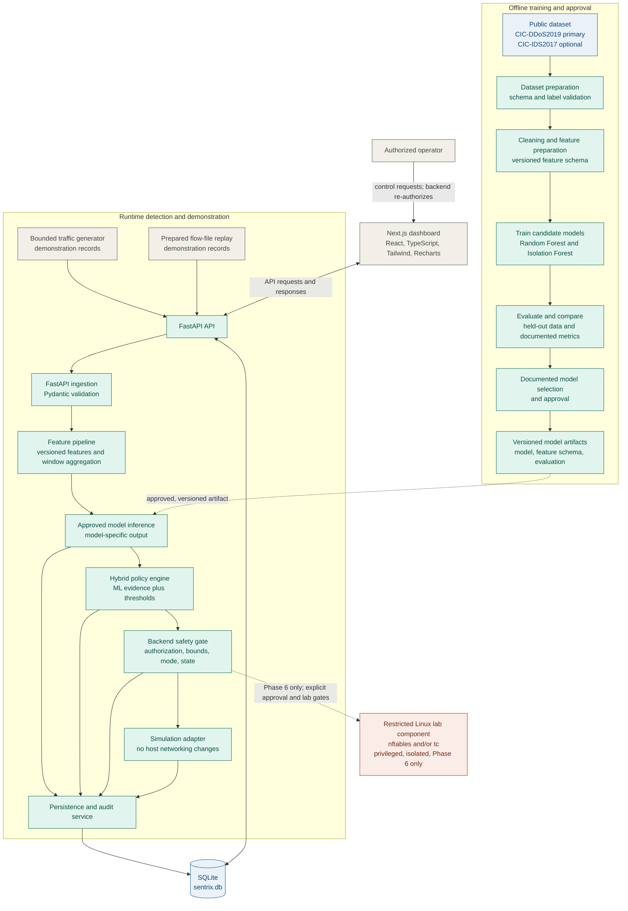

# SENTRIX DDoS Defense Platform: System Architecture

This document describes the **intended design** for SENTRIX. Components,
endpoints, and workflows below are planned contracts, not claims that the
corresponding features are implemented or operational. Phase exit criteria are
tracked in [IMPLEMENTATION_PLAN.md](IMPLEMENTATION_PLAN.md).

## 1. Architecture overview

SENTRIX is planned as a Python/FastAPI modular monolith with Pydantic request
validation, SQLite persistence in `sentrix.db`, and a Next.js/React/TypeScript
dashboard using Tailwind CSS and Recharts. scikit-learn Random Forest and
Isolation Forest are candidate models. The model selected for runtime use must
be documented and approved after evaluation; neither candidate is presumed to
be selected.

### Boundaries and responsibilities

- **Input to ingestion:** Generated and replayed records are untrusted inputs.
  Both use the same validation and runtime pipeline. They are demonstration
  records, **not live network telemetry**. Public training datasets belong to
  the separate offline pipeline.
- **Dashboard to backend:** The dashboard presents data and submits operator
  requests; it is not an authority for enforcement. The backend must validate
  requests, authenticate and authorize protected operations, and apply the
  safety gate regardless of dashboard behavior.
- **Backend to database:** The backend owns persistence through its storage
  layer. SQLite is the planned initial store; the dashboard does not access it
  directly.
- **Backend to privileged lab component:** Lab enforcement is a separate,
  restricted component. It accepts validated actions rather than arbitrary
  commands or rule expressions. The API process is to remain unprivileged.
- **Training artifacts to runtime:** Only an artifact from the documented
  selection and approval step is eligible for runtime inference. Training and
  inference must use the same versioned feature definitions and preprocessing.
- **Operator controls to safety gate:** Controls pass through the backend and
  are independently authorized there. UI visibility or confirmation is not a
  substitute for backend authorization.

The solid arrows show the ordinary demonstration and data paths. Dashed arrows
are limited to approved training-artifact handoff and the deferred lab-only
path. Lab enforcement is not an automatic fallback from simulation.

## 2. Offline model pipeline

The offline workflow prepares and validates public labeled data, cleans
records, creates reproducible leakage-aware splits, and applies the versioned
feature schema. CIC-DDoS2019 is the primary dataset candidate; CIC-IDS2017 is
optional under the PRD. Dataset provenance, license, versions, and label
meaning must be reviewed before use.

Both Random Forest and Isolation Forest are candidates to train and evaluate.
Evaluation and comparison must use held-out data and the PRD metrics, including
precision, recall, F1-score, confusion matrix, false-positive rate, inference
latency, and resource use. Any selection and thresholds must be documented.
Versioned artifacts and their feature schema and evaluation information become
available to runtime inference only after that selection and approval; this
document does not select a model or assert measured performance.

The score meanings are model-specific:

- A Random Forest prediction or probability is a model output, not necessarily
  a calibrated confidence.
- An Isolation Forest anomaly score follows its documented score convention
  and is **not a probability** unless calibration is explicitly defined and
  validated.

## 3. Runtime detection and policy

The initial demonstration accepts both generated traffic-flow records and
prepared traffic-flow records replayed from a file. Both inputs pass through
the same ingestion, validation, feature processing, inference, policy,
persistence, and reporting path. They must not be presented as live telemetry.

```mermaid
flowchart LR
    GEN["Generator<br/>demonstration records"]
    FILE["Prepared file replay<br/>demonstration records"]
    VALID["Ingestion and validation"]
    FEATURES["Feature pipeline<br/>and window aggregation"]
    INFER["Approved model inference"]
    POLICY{"Hybrid policy<br/>ML signal and threshold signal"}
    NONE["Neither signal<br/>Continue monitoring"]
    ONE["Exactly one signal<br/>Alert and gather evidence"]
    BOTH["Both signals<br/>Consider bounded mitigation request"]
    GATE["Safety gate<br/>authorization, target, bounds, mode"]
    SIM["Simulation adapter"]
    DB[("Database and audit")]
    DASH["Dashboard and API reporting"]
    REJECT["Reject invalid input<br/>no mitigation"]
    LAB["Restricted Linux lab component<br/>deferred and separately gated"]

    GEN --> VALID
    FILE --> VALID
    VALID -->|"invalid"| REJECT
    VALID -->|"valid"| FEATURES --> INFER --> POLICY
    POLICY -->|"no / no"| NONE
    POLICY -->|"one signal only"| ONE
    POLICY -->|"both signals"| BOTH
    NONE --> DB
    ONE --> DB
    BOTH --> GATE
    GATE -->|"default mode"| SIM
    GATE -.->|"Phase 6 only; explicit lab approval"| LAB
    GATE --> DB
    SIM --> DB
    LAB -.->|"lab outcome"| DB
    DB --> DASH

    classDef core fill:#E1F5EE,stroke:#0F6E56,color:#085041;
    classDef warn fill:#FAEEDA,stroke:#854F0B,color:#633806;
    classDef lab fill:#FAECE7,stroke:#993C1D,color:#712B13;
    classDef neutral fill:#F1EFE8,stroke:#5F5E5A,color:#444441;
    classDef reject fill:#FCEBEB,stroke:#A32D2D,color:#791F1F;

    class VALID,FEATURES,INFER,POLICY,BOTH,GATE,SIM,DB,DASH core;
    class ONE warn;
    class LAB lab;
    class GEN,FILE,NONE neutral;
    class REJECT reject;
```

The hybrid policy considers the model's model-specific detection evidence and
configured traffic thresholds. Neither signal means continue monitoring. One
signal means create an alert and gather evidence; under the policy represented
here, a single signal is not sufficient for mitigation. Both signals may
request a bounded action, but do not bypass authorization, target checks,
limits, mode checks, or operator controls in the safety gate. No numeric
threshold, score cutoff, or model performance value is specified here.

The PRD and implementation plan follow this policy: either single signal
alone produces an alert and evidence gathering, not mitigation. Only when both
signals indicate a threat may the policy consider a bounded request through
the safety gate.

## 4. Safety, mitigation, and lifecycle

Simulation is the default mode. Simulation records a proposed response for
demonstration and audit; it must not modify host networking, invoke privileged
enforcement operations, or execute networking-modification commands. A
simulated action is never an applied network change.

Every action request must pass through the backend safety gate. The gate is
responsible for verifying authentication and authorization, target validity,
protected targets, bounded parameters (including rate, burst, duration, and
concurrency limits as defined by the project), current mode, and applicable
operator-disable state. The model must not execute shell commands or directly
control networking.

An authorized operator can cancel eligible actions and activate the emergency
disable control. Cancellation, expiry, cleanup, and recovery are distinct:
cancellation requests that an eligible action stop; cleanup removes only
SENTRIX-owned resources; recovery verifies and resolves state after failure or
uncertainty. Cancellation does not itself imply that a previous network state
has been restored. Unrelated firewall rules and traffic-control settings must
never be removed.

### Mitigation lifecycle

Valid transitions must be enforced by the backend and audited. Terminal states
must not be reopened as if the earlier outcome had not occurred.

| State | Meaning |
| --- | --- |
| `proposed` | A policy has requested an action; it has not been simulated or applied. |
| `simulated` | The action was recorded in simulation mode only; no host networking change or privileged operation occurred. |
| `applied` | A permitted lab action was applied and verified on the designated lab resource. This state is unavailable in simulation mode. |
| `failed` | The requested operation or its required verification failed. New lab enforcement requests remain disabled when state is uncertain. |
| `cancelled` | An eligible action was cancelled. For an applied action, this state is recorded only after cleanup of its SENTRIX-owned change is verified. |
| `expired` | An applied action reached its defined duration and removal of its SENTRIX-owned change was verified. |
| `recovered` | A failed or uncertain lab state was reconciled and safely resolved, with the outcome audited. |

Expected transitions are `proposed` to `simulated`, `applied`, `failed`, or
`cancelled`; `applied` to `cancelled`, `expired`, or `failed`; and `failed` to
`recovered` only after safe resolution is verified. `simulated`, `cancelled`,
`expired`, and `recovered` are terminal outcomes. A cleanup failure is recorded
as `failed`, not as successful cancellation or expiry. Implementation must
represent a pending cleanup/reconciliation operation without falsely claiming
that cleanup has completed; the precise persistence representation is an open
implementation decision.

Persisted actions must be reconciled against actual lab state after restart
before enforcement can be permitted. If state is uncertain or reconciliation
is incomplete, enforcement remains disabled until safely resolved. Expiry,
cleanup, and recovery apply only to SENTRIX-owned actions and resources.

### Linux lab enforcement gate

Linux enforcement using `nftables` and/or `tc` is a separate, privileged,
restricted component for an isolated lab. It is disabled by default and must
not be a normal or automatic fallback from simulation. Enabling it requires
all of the following:

1. End-to-end simulation tests pass.
2. Tests verify simulation does not alter host networking.
3. Authorization, action bounds, cancellation, and emergency-disable
   behavior are tested.
4. Lab enforcement, expiry, cleanup, restart reconciliation, and recovery are
   verified in an isolated environment.
5. Required release gates pass and explicit lab approval is given.

The API service must remain unprivileged. The lab component must accept only
validated policy objects, be restricted to the designated lab interface and
test network, and manage only SENTRIX-owned rules or resources. Failures must
be surfaced and audited; uncertain or unreconciled state keeps enforcement
disabled.

## 5. Trust, authorization, and operator permissions

The API requires authentication by default according to the PRD. Backend
authorization is required for protected administrative actions. The dashboard
may hide or disable controls for users without permission, but the backend
must enforce permissions independently.

| Operation | Authorization consideration |
| --- | --- |
| Read operational data | Read access is required; exact access policy is to be defined. |
| Change thresholds | Protected administrative operation; the implementation plan identifies this as admin-only. |
| Cancel an action | Authorized operator action; eligibility and role mapping must be enforced by the backend. |
| Emergency disable | Protected operator control; authorization and behavior must be tested. |
| Read or export audit records | Authorized access is required by the PRD; exact role mapping and export policy remain to be defined. |
| Approve lab enforcement | Explicit lab approval is required in addition to the tested release gates; approver identity and authorization mechanism remain open. |

The PRD does not define a complete authentication implementation or role
model. The implementation plan suggests viewer/admin roles; the exact role
definitions, assignment process, and permission matrix remain an open design
decision and must not be inferred from dashboard behavior.

## 6. Persistence, audit, and reporting

SQLite in `sentrix.db` is the planned initial persistence layer. Its intended
responsibilities include:

- Traffic observations or derived traffic summaries.
- Detection results, including model version, feature-schema version,
  model-specific score or prediction type, and timestamp as required by the
  design.
- Alerts and their status.
- Mitigation action lifecycle states, outcomes, and audit history.
- Threshold configuration and model-version metadata.
- Audit records for detections, policy decisions, operator actions, and
  enforcement outcomes.

This document does not prescribe a final database schema, retention period,
or fields beyond requirements stated in the PRD and implementation plan.
Those details remain implementation decisions. The dashboard reads data
through the backend API and should clearly distinguish normal, suspicious,
simulated, and applied states; stale or demonstration data must not be shown
as live measurements.

## 7. Planned API contract

The following are target contracts from PRD v1.1, not confirmation that the
routes are implemented. Requests use Pydantic validation and the `/api/v1`
prefix. Administrative routes require authentication and appropriate
authorization.

| Method | Endpoint | Intended meaning |
| --- | --- | --- |
| `GET` | `/api/v1/health` | API and service health. |
| `GET` | `/api/v1/models` | Model versions and active model. |
| `GET` | `/api/v1/models/metrics` | Model evaluation metrics. |
| `POST` | `/api/v1/traffic/flows` | Submit validated traffic-flow observations. |
| `GET` | `/api/v1/traffic/summary` | Retrieve traffic and time-window summaries. |
| `POST` | `/api/v1/detection/analyze` | Analyze flow and window features. |
| `GET` | `/api/v1/alerts` | Retrieve filtered, paginated alerts. |
| `GET` | `/api/v1/mitigations` | Retrieve mitigation history and status. |
| `POST` | `/api/v1/mitigations/simulate` | Evaluate and record a simulated mitigation. |
| `POST` | `/api/v1/mitigations/{id}/cancel` | Cancel an authorized eligible action. |
| `POST` | `/api/v1/mitigations/disable` | Disable mitigation actions through an authorized operator control. |
| `GET` | `/api/v1/audit` | Retrieve authorized audit records; optional `format=json\|csv`, default `json`. |
| `GET` | `/api/v1/config/thresholds` | Read threshold configuration. |
| `PATCH` | `/api/v1/config/thresholds` | Update authorized threshold settings. |

## 8. Implementation phases and exit criteria

The phases below use the names and exit conditions in
`IMPLEMENTATION_PLAN.md`; the PRD's phase scope is consistent at this level.
The implementation plan contains more detailed sub-phase completion criteria.

| Phase | Name | Exit criterion |
| --- | --- | --- |
| 1 | Foundation and skeleton | Baseline requirements approved; `/api/v1/health` works, all five dashboard routes load, and CI passes. |
| 2 | Data and ML baseline | Reproducible training and evaluation report (the ML gate); selection is documented before runtime use. |
| 3 | Backend, detection and policy | Every PRD endpoint matches its documented schema, authorization tests pass, and a flow submission produces a stored detection, alert, and simulated action. |
| 4 | Dashboard | All five pages show real API data; errors and stale states display correctly, and simulation versus enforcement is always distinguishable. |
| 5 | Simulation and integration testing | Critical detection, policy, authorization, and no-network-change tests pass (the simulation gate). |
| 6 | Isolated Linux lab | Enforcement, expiry, restart reconciliation, and recovery are verified in isolation (the Linux lab gate). |
| 7 | Release hardening | Release gates are recorded, documentation is complete, no unresolved critical security issues remain, and emergency disable and operations documentation are complete. |

The Linux lab phase follows—not substitutes for—the simulation gate. The
release process must record the ML, simulation, Linux lab, and release gate
results in order. No phase status is asserted by this architecture document.

## 9. Requirements and open design decisions

The PRD is the requirements source of truth. The following details are not
fully specified and should be resolved in implementation without fabricating
values or guarantees:

- Final feature schema, model selection, score conventions, thresholds, and
  measured performance.
- Exact database schema, retention periods, and any additional persisted
  fields.
- Authentication mechanism, role definitions, and complete permission
  matrix.
- Persistence representation for pending cleanup and reconciliation.
- Lab approval authority and the operational procedure for enabling lab mode.
- Any deployment details beyond the PRD's local, web, and isolated-lab
  environments.

Until those decisions and required tests are complete, describe endpoints and
components as planned, keep simulation as the default, and keep Linux
enforcement disabled.
