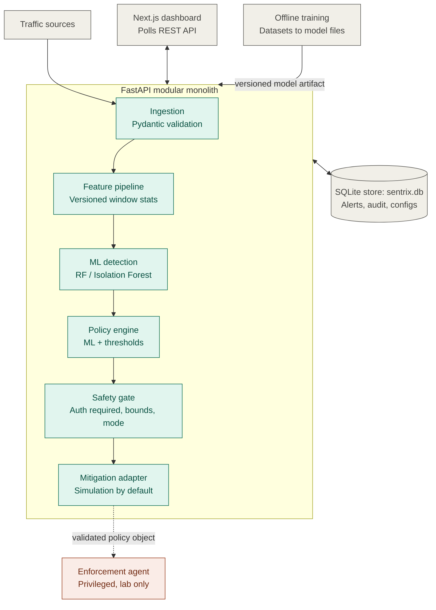
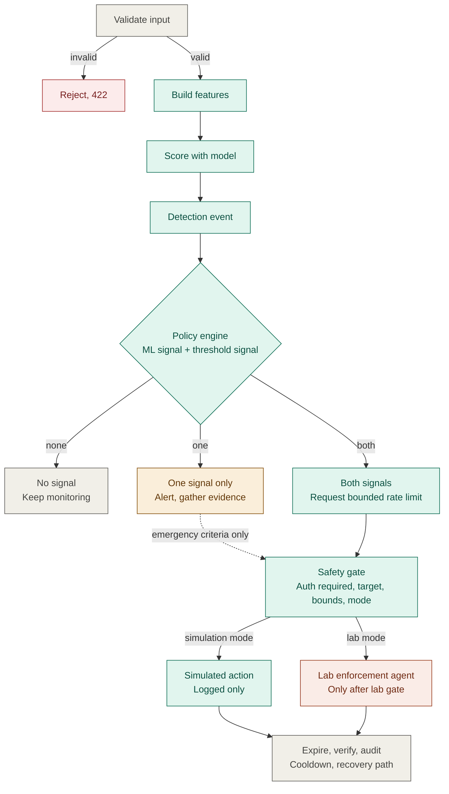

# SENTRIX DDoS Defense Platform: Diagrams

## 1. System architecture

## 2. Detection and policy workflow

## Notes

- Dashed arrows mean "lab phase only" or "emergency criteria only".
- These render natively on GitHub, GitLab, VS Code (Markdown Preview Mermaid Support extension), Obsidian, and at https://mermaid.live.

## Target API and configuration contract (PRD v1.1)

The FastAPI service is planned to expose the following versioned endpoints:

- `GET /api/v1/health` — service health.
- `GET /api/v1/models` and `GET /api/v1/models/metrics` — model versions and evaluation metrics.
- `POST /api/v1/traffic/flows` and `GET /api/v1/traffic/summary` — submit observations and retrieve traffic summaries.
- `POST /api/v1/detection/analyze` — analyze features and return a model-specific result.
- `GET /api/v1/alerts` — retrieve filtered, paginated alerts.
- `GET /api/v1/mitigations` — retrieve mitigation history and status.
- `POST /api/v1/mitigations/simulate` — evaluate and record a simulated action.
- `POST /api/v1/mitigations/{id}/cancel` — cancel an authorized mitigation.
- `POST /api/v1/mitigations/disable` — disable mitigation actions through an authorized operator control.
- `GET /api/v1/audit` — retrieve authorized audit records; optional `format=json|csv` export, defaulting to JSON.
- `GET /api/v1/config/thresholds` and `PATCH /api/v1/config/thresholds` — read and update threshold configuration.

API authentication is required by default. Local development may use the
placeholder token in `.env.example`; replace it outside local development
and never commit a real token. Mitigation defaults to `simulation`, and
the SQLite database filename is `sentrix.db`. These are target contracts;
implementation is tracked by phase in `IMPLEMENTATION_PLAN.md`.