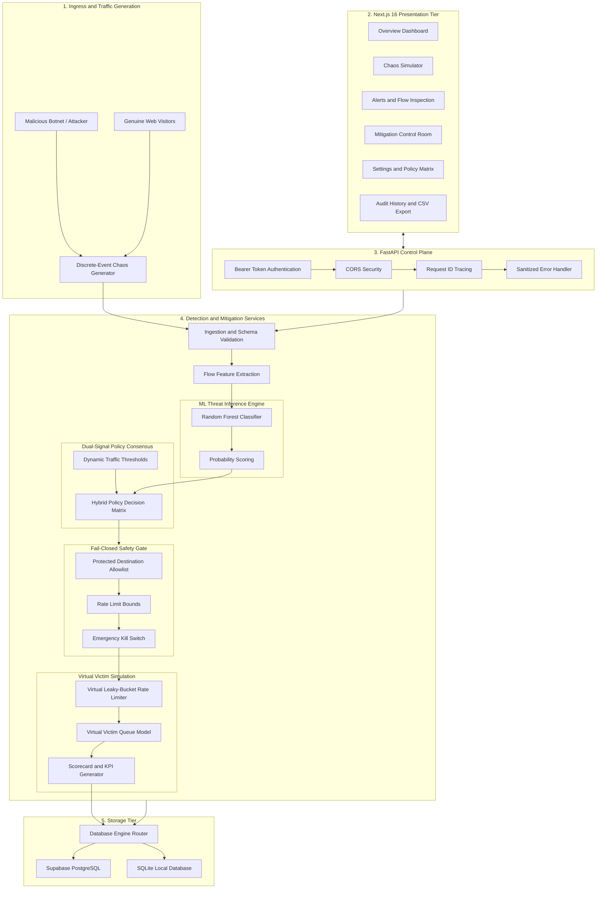
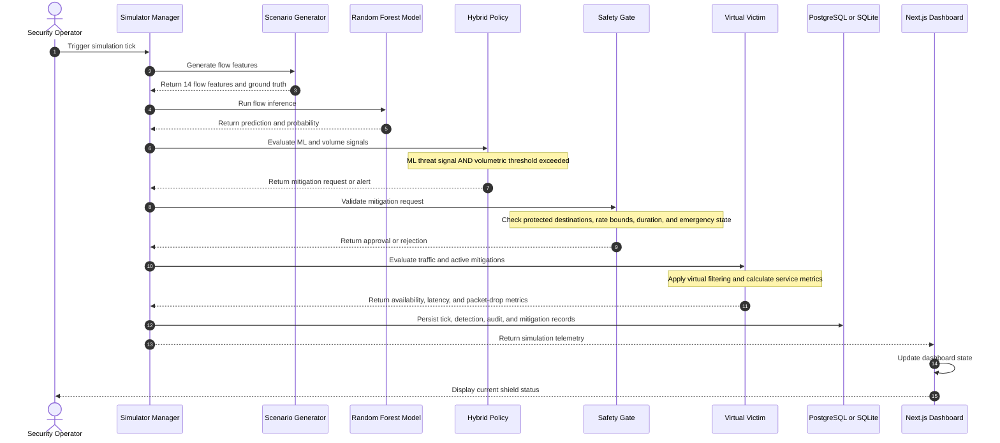
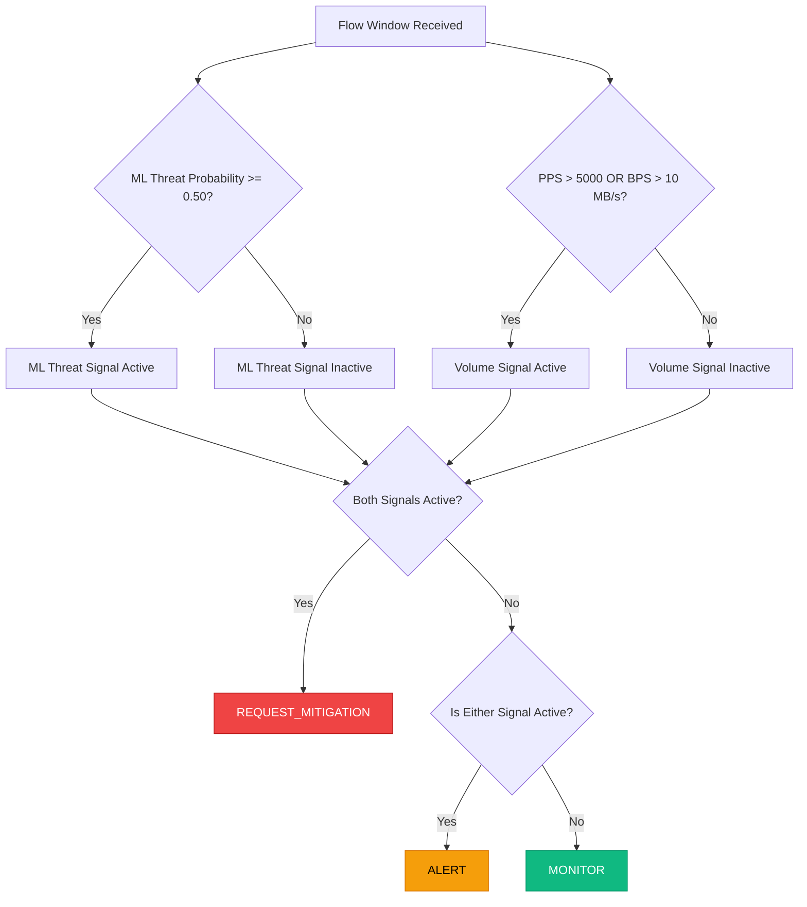
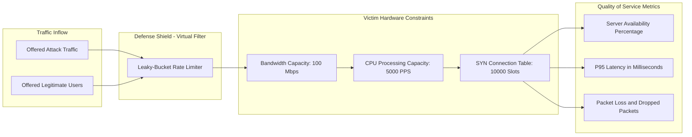

# SENTRIX System Architecture & Design Specification

SENTRIX is an autonomous, machine-learning-driven DDoS detection and mitigation simulation platform. It combines trained flow-level AI classification model with volumetric threshold telemetry to protect web infrastructure without causing collateral damage to legitimate visitors.

---

## 1. High-Level System Architecture

---

## 2. Component Interaction and Simulation Tick Sequence

The following sequence describes one virtual simulation tick, where the simulation interval is one second.

---

## 3. Dual-Signal Hybrid Policy Decision Matrix

SENTRIX requires both the ML threat signal and the volumetric threshold signal before requesting mitigation. A single signal produces an alert rather than automatically engaging the shield.

---

## 4. Virtual Victim Hardware Physics Model

To avoid modifying physical host network interfaces (`iptables`, `netsh`, or operating system firewall rules), SENTRIX simulates victim-server degradation using a virtual queueing model.

### 4.1 Simulation Constraints

- **Bandwidth capacity:** Default 100 Mbps.
- **CPU packet-processing capacity:** Default 5000 packets per second (PPS).
- **SYN connection table:** Default 10000 concurrent connection slots.
- **Virtual rate limiter:** Simulates traffic filtering without modifying host networking.
- **Availability:** Calculated from the victim's simulated ability to serve legitimate traffic.
- **Latency:** Estimated from queueing delay and resource saturation.
- **Packet loss:** Includes attack traffic dropped by the virtual filter and legitimate traffic lost due to congestion or filtering.

The model must calculate packet drops, latency, and availability from actual simulation inputs. Values such as 95% attack drops or 2% collateral drops are configurable targets, not guaranteed outcomes.

### 4.2 Safety and Isolation

All resource limits belong to the virtual victim model. They must not be interpreted as measurements of the physical host's actual hardware capacity. SENTRIX must clearly label simulated metrics in its dashboard and reports.

## 5. Security & Isolation Architecture

### 5.1 Host Isolation Invariance

- All mitigation actions operate entirely in application memory through virtual mitigation records.
- No host operating system firewall rules, kernel modules, network interfaces, or physical packet-filtering mechanisms are modified.
- The simulation engine must not execute privileged networking commands.
- Simulation results must remain separate from real-world enforcement status.

### 5.2 Fail-Closed Safety Gate

Every mitigation request must pass through `validate_safety_gate()` before a virtual mitigation is created.

If validation fails, the request must be rejected. If a required safety check cannot be completed, SENTRIX must not activate the mitigation.

#### Protected Destination Allowlist

Mitigation must be blocked for protected destination addresses, including:

- IPv4 loopback range: `127.0.0.0/8`
- IPv6 loopback address: `::1`
- Configured default gateway addresses, such as `192.168.1.1` and `10.0.0.1`
- Configured DNS resolver addresses, such as `8.8.8.8` and `1.1.1.1`

These are examples of protected addresses, not an exhaustive list. Actual gateway and DNS addresses must be configurable for the deployment environment.

Destination addresses must be parsed and validated using an IP address library. String matching alone is insufficient.

#### Rate Limit Bounds

- Minimum permitted rate limit: `100 PPS`
- Maximum permitted rate limit: `50000 PPS`

Requests outside this range must be rejected before mitigation activation.

#### Mitigation Duration Bounds

- Minimum duration: `10 seconds`
- Maximum duration: `300 seconds`

Every mitigation must have a validated expiration time. Expired mitigations must not remain active in the simulation state.

### 5.3 Emergency Disable Kill Switch

The endpoint `POST /api/v1/mitigations/disable` provides an emergency mechanism for disabling active virtual mitigations.

The endpoint must:

1. Require operator authentication and authorization.
2. Disable all active virtual mitigation rules.
3. Record the operator action, timestamp, and result in the audit log.
4. Return the resulting mitigation state.
5. Prevent new mitigation activation while the emergency-disable state is enabled.
6. Require an explicit authorized action to restore mitigation capability.

The kill switch must update the authoritative backend state, not merely change the frontend shield indicator.

### 5.4 Authentication and API Security

- Protect control-plane endpoints using the configured backend authentication mechanism.
- Keep secret API tokens on the server; do not expose privileged tokens in public frontend environment variables.
- Validate request payloads and reject malformed or out-of-range values.
- Configure CORS to permit only approved frontend origins.
- Return sanitized error responses without exposing secrets, stack traces, or internal database details.
- Use request IDs to correlate API requests, errors, and audit events.

### 5.5 Auditability and Fail-Safe Behavior

Every mitigation decision should record:

- Detection and policy decision identifiers.
- Model version and applicable threshold configuration.
- Safety validation outcome and rejection reason, where applicable.
- Mitigation activation, expiration, or emergency-disable event.
- Simulation tick identifier and relevant telemetry.
- Timestamp in UTC.

If the ML model, policy engine, persistence layer, or safety validation becomes unavailable, SENTRIX must not silently activate a mitigation. The system should report the failure, record it where possible, and retain the fail-closed behavior.

All mitigation behavior described in this section applies to virtual simulation actions. Physical firewall enforcement requires a separate implementation, explicit authorization, and safety testing.

