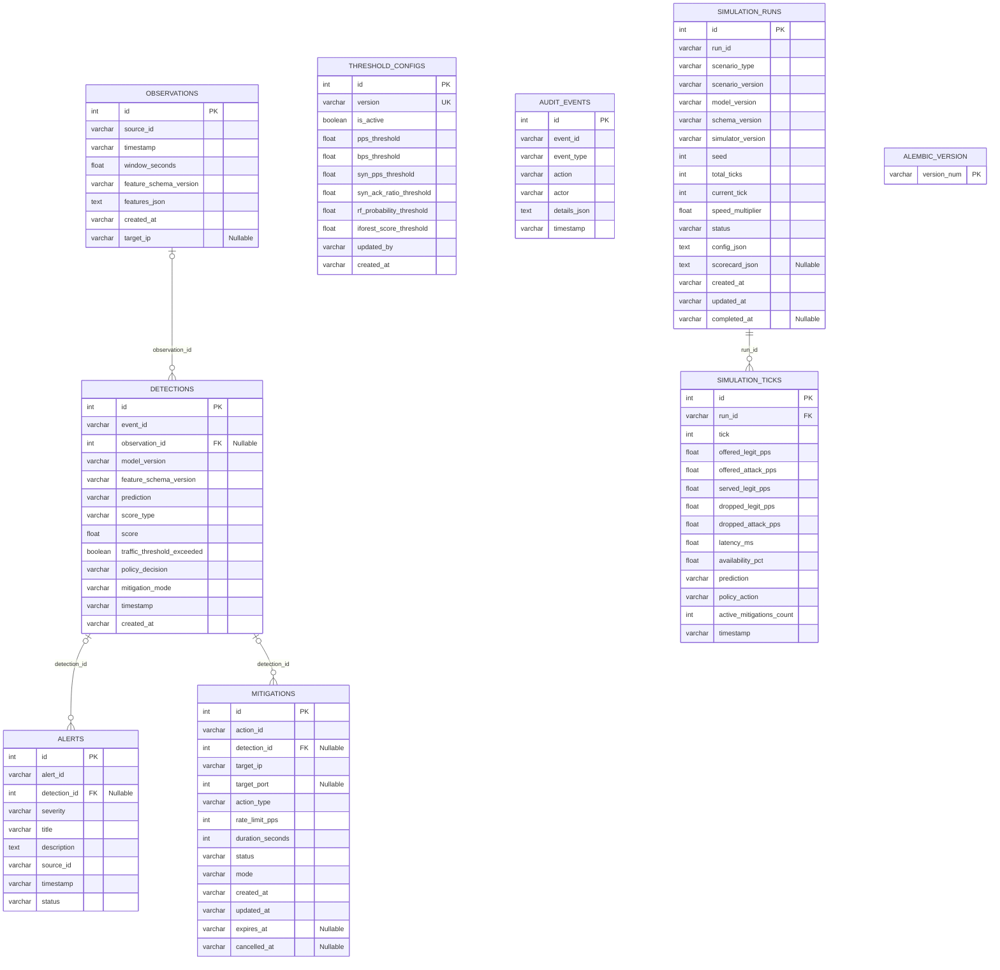
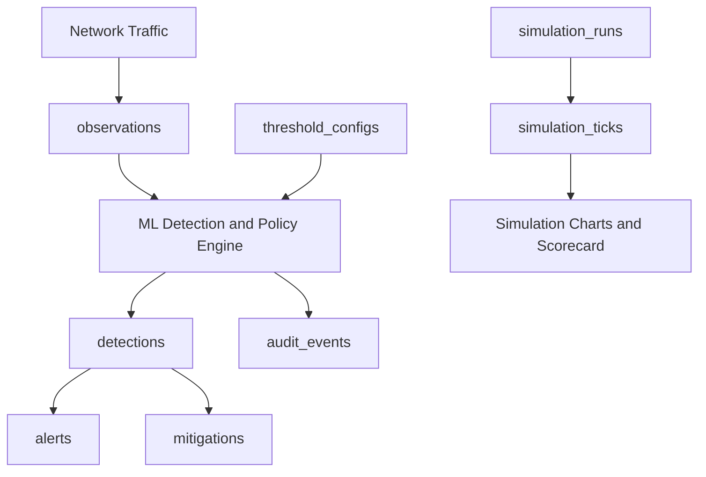

# SENTRIX Database Architecture & Entity-Relationship Schema

## Overview

SENTRIX uses **SQLAlchemy ORM** as its database access layer, with support for two database dialects:

- **Supabase PostgreSQL** — intended for cloud deployment. Connection pooling should be configured according to the selected Supabase connection method and hosting environment.
- **SQLite** — useful for local development and isolated integration testing.

The database stores observed network traffic, machine-learning detections, alerts, mitigation actions, detection thresholds, audit history, and simulation results.

This document describes the nine tables in the supplied SENTRIX schema, explains their columns in plain English, and summarizes their logical relationships.

> **Schema note:** The ER diagram below represents the intended logical relationships described in the schema. Confirm the actual foreign-key constraints in the deployed database before treating every relationship as a database-enforced constraint. In particular, verify whether `simulation_ticks.run_id` references `simulation_runs.run_id`.

---

## 1. Visual Entity-Relationship (ER) Diagram

### 1.1 Relationship Summary

| Relationship | Cardinality | Purpose |
|---|---|---|
| `OBSERVATIONS` → `DETECTIONS` | One-to-many | One observation may be associated with multiple detection records. Each detection can reference zero or one observation because `observation_id` is nullable. |
| `DETECTIONS` → `ALERTS` | One-to-many | One detection may be associated with multiple alerts. Each alert can reference zero or one detection because `detection_id` is nullable. |
| `DETECTIONS` → `MITIGATIONS` | One-to-many | One detection may be associated with multiple mitigation actions. Each mitigation can reference zero or one detection because `detection_id` is nullable. |
| `SIMULATION_RUNS` → `SIMULATION_TICKS` | One-to-many, intended | One simulation run can contain many tick records. Verify that the database enforces the relationship between `simulation_runs.run_id` and `simulation_ticks.run_id`. |

The `THRESHOLD_CONFIGS`, `AUDIT_EVENTS`, and `ALEMBIC_VERSION` tables are not connected to other tables in this ER diagram. That does not rule out application-level relationships that are not represented here.

---

## 2. Table and Column Reference

### 2.1 `observations` — Network Traffic Records

**Purpose:** Stores information about traffic observed by SENTRIX. Traffic features can be used as input to machine-learning models.

| Column | Purpose |
|---|---|
| `id` | Primary key: unique database ID for each observation. |
| `source_id` | Identifies the source or sensor that reported the traffic. |
| `timestamp` | Time when the traffic was observed. |
| `window_seconds` | Duration of the traffic measurement window, in seconds. |
| `feature_schema_version` | Version of the format used to represent traffic features. |
| `features_json` | Traffic features stored as JSON text. |
| `created_at` | Time when the observation record was saved. |
| `target_ip` | Destination IP address associated with the observation; nullable. |

**Example:** SENTRIX records a one-second traffic window and stores the extracted numerical features in `features_json`.

### 2.2 `detections` — Machine-Learning Results and Policy Decisions

**Purpose:** Stores traffic classification results, model scores, and decisions produced by the policy engine.

| Column | Purpose |
|---|---|
| `id` | Primary key: unique database ID for the detection. |
| `event_id` | Identifier for the detection event. |
| `observation_id` | ID of the associated observation; nullable. |
| `model_version` | Version of the ML model used. |
| `feature_schema_version` | Version of the feature format used for the prediction. |
| `prediction` | Model classification, such as `benign` or `suspicious`, depending on the application's defined labels. |
| `score_type` | Describes the type of score produced by the model. |
| `score` | Numerical score associated with the prediction. |
| `traffic_threshold_exceeded` | Indicates whether a configured traffic threshold was exceeded. |
| `policy_decision` | Policy-engine decision, such as monitoring, alerting, or requesting mitigation, according to the implementation. |
| `mitigation_mode` | Mode associated with the mitigation decision, such as simulation or dry-run, according to the implementation. |
| `timestamp` | Time associated with the detection. |
| `created_at` | Time when the detection record was saved. |

**Example:** A Random Forest model classifies an observation as suspicious. SENTRIX records the prediction, score, model version, and policy decision.

**Important:** Do not automatically interpret `score` as an attack probability. Its meaning depends on `score_type` and the model's output. A probability interpretation requires a probability-producing model output and appropriate calibration.

### 2.3 `alerts` — Security Warnings

**Purpose:** Stores security alerts for display to operators and for tracking alert status.

| Column | Purpose |
|---|---|
| `id` | Primary key: unique database ID for the alert. |
| `alert_id` | Identifier for the alert. |
| `detection_id` | Associated detection ID; nullable. |
| `severity` | Alert severity, using the values defined by the application. |
| `title` | Short title describing the alert. |
| `description` | Detailed explanation of the alert. |
| `source_id` | Identifier of the traffic source associated with the alert. |
| `timestamp` | Time associated with the alert. |
| `status` | Current alert status, using the values supported by the application. |

**Example:** SENTRIX detects unusually high traffic volume and records an alert titled `High Traffic Volume Detected`. An operator can review the alert and update its status if the application supports that workflow.

### 2.4 `mitigations` — Defense Actions

**Purpose:** Stores mitigation action details, including the target, configured limits, duration, and lifecycle status.

| Column | Purpose |
|---|---|
| `id` | Primary key: unique database ID for the mitigation. |
| `action_id` | Identifier for the mitigation action. |
| `detection_id` | Detection associated with the action; nullable. |
| `target_ip` | Destination IP address the action is intended to protect. |
| `target_port` | Destination port being protected; nullable. |
| `action_type` | Type of mitigation, such as rate limiting, depending on the implementation. |
| `rate_limit_pps` | Configured packet-rate limit, in packets per second. |
| `duration_seconds` | Intended duration of the mitigation. |
| `status` | Current action status, using the values defined by the application. |
| `mode` | Execution mode, such as simulation or another supported mode. |
| `created_at` | Time when the action was created. |
| `updated_at` | Time when the record was last updated. |
| `expires_at` | Scheduled expiration time; nullable. |
| `cancelled_at` | Cancellation time; nullable. |

**Example:** SENTRIX creates a simulated rate-limit action for a target IP address, with a configured limit of 2,000 packets per second for 30 seconds.

**Important:** A database record alone does not prove that a real firewall or operating-system rule was applied. In simulation mode, the action is virtual.

### 2.5 `threshold_configs` — Detection Threshold Settings

**Purpose:** Stores threshold values used by SENTRIX's traffic-analysis and policy logic.

| Column | Purpose |
|---|---|
| `id` | Primary key: unique database ID for the configuration. |
| `version` | Configuration version; marked unique (`UK`) in the supplied schema. |
| `is_active` | Indicates whether the configuration is marked active. |
| `pps_threshold` | Packet-per-second threshold. |
| `bps_threshold` | Bit-per-second threshold. |
| `syn_pps_threshold` | Threshold for SYN packets per second. |
| `syn_ack_ratio_threshold` | Configured threshold for the SYN-to-ACK traffic ratio. |
| `rf_probability_threshold` | Decision cutoff for the Random Forest output. |
| `iforest_score_threshold` | Configured cutoff for the Isolation Forest score. |
| `updated_by` | Operator or system responsible for the update. |
| `created_at` | Time when the configuration was created. |

**Example:** If `pps_threshold` is set to `5000` and observed traffic reaches 7,000 packets per second, the traffic-volume threshold may be triggered.

Exceeding a threshold does not, by itself, prove that an attack is occurring. Legitimate traffic spikes can also exceed configured limits.

### 2.6 `audit_events` — Activity and Audit History

**Purpose:** Records important system and operator activities for accountability and troubleshooting.

| Column | Purpose |
|---|---|
| `id` | Primary key: unique database ID for the audit record. |
| `event_id` | Identifier for the audit event. |
| `event_type` | Category of the event. |
| `action` | Action that occurred. |
| `actor` | Person, service, or system that performed the action. |
| `details_json` | Additional event details stored as JSON text. |
| `timestamp` | Time when the event occurred. |

**Example:** An operator changes a detection threshold. An audit event can record the action, actor, timestamp, and additional details.

This table supports auditing, but tamper-resistant audit history requires additional security controls.

### 2.7 `simulation_runs` — Simulation Session Details

**Purpose:** Stores metadata and configuration for an entire simulation session.

| Column | Purpose |
|---|---|
| `id` | Primary key: unique database ID for the simulation run. |
| `run_id` | Identifier for the simulation session. |
| `scenario_type` | Type of simulated scenario. |
| `scenario_version` | Version of the scenario configuration. |
| `model_version` | ML model version used in the run. |
| `schema_version` | Version of the data or feature schema. |
| `simulator_version` | Version of the simulation engine. |
| `seed` | Random seed that can help reproduce a simulation. |
| `total_ticks` | Total number of planned simulation steps. |
| `current_tick` | Current simulation step. |
| `speed_multiplier` | Simulation speed multiplier, such as 1x or 10x. |
| `status` | Current run status, according to the application's supported values. |
| `config_json` | Simulation settings stored as JSON text. |
| `scorecard_json` | Final performance results stored as JSON text; nullable. |
| `created_at` | Time when the run was created. |
| `updated_at` | Time when the run was last updated. |
| `completed_at` | Time when the run finished; nullable. |

**Example:** A 60-tick SYN flood simulation is created. This table stores its scenario, configuration, model version, progress, and final scorecard.

### 2.8 `simulation_ticks` — Results for Each Simulation Step

**Purpose:** Stores per-step measurements and decisions for a simulation run. These records can power simulation charts and performance dashboards.

| Column | Purpose |
|---|---|
| `id` | Primary key: unique database ID for the tick record. |
| `run_id` | Identifier of the simulation run this tick belongs to; marked as a foreign key in the supplied diagram. |
| `tick` | Simulation step number. |
| `offered_legit_pps` | Legitimate traffic offered to the simulated system, in packets per second. |
| `offered_attack_pps` | Attack traffic offered to the simulated system, in packets per second. |
| `served_legit_pps` | Legitimate traffic successfully served, in packets per second. |
| `dropped_legit_pps` | Legitimate traffic dropped, in packets per second. |
| `dropped_attack_pps` | Attack traffic dropped by the simulated defense, in packets per second. |
| `latency_ms` | Simulated response latency in milliseconds. |
| `availability_pct` | Simulated service availability percentage. |
| `prediction` | ML prediction associated with the tick. |
| `policy_action` | Policy decision or action associated with the tick. |
| `active_mitigations_count` | Number of active mitigation actions at that step. |
| `timestamp` | Time associated with the tick record. |

**Example:** At tick 20, the simulator records offered traffic, served legitimate traffic, dropped traffic, latency, availability, the prediction, and the policy action.

These records can support:
- Attack traffic versus legitimate traffic charts.
- Detection and mitigation timelines.
- Simulated service availability and latency charts.
- Comparisons of mitigation strategies.
- Evaluation of different ML models and policy configurations.

### 2.9 `alembic_version` — Database Migration Version

**Purpose:** Tracks the migration revision recorded by Alembic, the database migration tool.

| Column | Purpose |
|---|---|
| `version_num` | Primary key identifying the migration revision recorded in the database. |

**Example:** When a migration adds a column or creates a table, Alembic tracks which migration revision has been applied.

Avoid modifying this table manually unless you are following a deliberate database recovery or migration procedure.

---

## 3. How the Tables Work Together

The following diagram illustrates the conceptual SENTRIX workflow:

In simple terms:

1. SENTRIX observes network traffic and stores the observation in `observations`.
2. The detection pipeline analyses the traffic using the selected model and policy settings.
3. The result and policy decision are stored in `detections`.
4. Depending on the application logic, SENTRIX may create an alert in `alerts` or a mitigation record in `mitigations`.
5. Important system or operator actions may be recorded in `audit_events`.
6. Simulation sessions are recorded in `simulation_runs`, while individual step results are stored in `simulation_ticks`.
7. Detection thresholds are stored in `threshold_configs`.
8. Alembic tracks the database migration revision in `alembic_version`.

This is a conceptual workflow. The exact order and conditions depend on the backend implementation.

---

## 4. Quick Reference

| Table | Main purpose | Question it answers |
|---|---|---|
| `observations` | Store observed network traffic | What traffic was observed? |
| `detections` | Store ML predictions and policy decisions | What did SENTRIX detect? |
| `alerts` | Store security warnings | What should the operator know? |
| `mitigations` | Store defense actions | What mitigation was configured or recorded? |
| `threshold_configs` | Store detection thresholds | What limits control detection? |
| `audit_events` | Store activity history | Who did what, and when? |
| `simulation_runs` | Store experiment-level information | Which simulation was run? |
| `simulation_ticks` | Store per-step simulation results | What happened at each simulation step? |
| `alembic_version` | Track migration revision | Which migration revision is recorded? |

---

## 5. Important Database Notes

- **Primary keys (`PK`)** uniquely identify rows in a table.
- **Foreign keys (`FK`)** link rows between tables when the database actually enforces those constraints.
- **Unique keys (`UK`)** prevent duplicate values in the constrained column or set of columns. In the supplied schema, `threshold_configs.version` is marked unique.
- **Nullable** means a column may contain `NULL`, indicating that a value is not provided.
- JSON values in `features_json`, `details_json`, `config_json`, and `scorecard_json` are described as text columns in this schema.
- The ER diagram represents the supplied logical design. Check the deployed database's constraints and indexes to confirm its physical schema.
- The presence of a row in `mitigations` does not guarantee that a real mitigation was enforced. Confirm the execution mode and enforcement implementation.
- Detection thresholds and model scores must be interpreted according to the actual model and policy implementation.

## Final Takeaway

The SENTRIX database supports four main areas:

1. **Traffic observation and detection** — `observations` and `detections`.
2. **Security response and accountability** — `alerts`, `mitigations`, and `audit_events`.
3. **Detection configuration** — `threshold_configs`.
4. **Simulation and evaluation** — `simulation_runs` and `simulation_ticks`.

`alembic_version` supports database schema management. Together, these tables provide the records needed to analyse traffic, review detection decisions, track security actions, and evaluate SENTRIX in simulation.
